# ClaudeTranslatorRust

Rust로 만든 Claude Cli를 이용한 GWS 번역기

ClaudeTranslator는 Windows 트레이에 상주하면서, Chrome에서 쓰는 Google Workspace(Chat, Gmail, Docs, Slides, Sheets)의 글을 **단축키 한 번으로 번역하거나 한글을 교정**하는 프로그램입니다.

- 번역은 이 PC에 설치된 **Claude Code CLI**를 불러서 합니다. 각자의 Claude 구독을 쓰므로 별도 API 비용이 들지 않습니다.
- 입력 중인 글을 번역문으로 **바로 바꿔 넣거나**, 원문은 그대로 두고 **번역 결과만 창으로 볼** 수 있습니다.
- Target 언어를 **여러 개** 고르면 정한 순서대로 모두 번역합니다.
- Google Sheets에서는 **셀 범위를 한 번에** 번역·교정합니다.

---

## 목차

1. [준비와 실행](#1-준비와-실행)
2. [단축키 요약](#2-단축키-요약)
3. [트레이 메뉴](#3-트레이-메뉴)
4. [번역 후 바꿔 넣기 (Alt+Alt)](#4-번역-후-바꿔-넣기-altalt)
5. [번역 결과 창으로 보기 (Ctrl+Ctrl)](#5-번역-결과-창으로-보기-ctrlctrl)
6. [앱별 동작](#6-앱별-동작)
7. [한글 교정](#7-한글-교정)
8. [개인 사전](#8-개인-사전)
9. [Settings](#9-settings)
10. [안내 메시지와 해결 방법](#10-안내-메시지와-해결-방법)
11. [데이터와 로그 위치](#11-데이터와-로그-위치)
12. [소스에서 빌드하기](#12-소스에서-빌드하기)

---

## 1. 준비와 실행

### 전제 조건

- Windows 10/11, Chrome
- **Claude Code CLI** 설치와 로그인(`claude login`). 번역 엔진으로 씁니다.
- 이전 Python 버전(ClaudeLangTrans v5)과 **동시에 실행하지 마세요.** 키보드 단축키가 두 프로그램에서 함께 동작합니다.

### 실행

1. `dist\ClaudeTranslator.exe`를 원하는 폴더에 복사해 실행합니다. 설치 과정이 없고, Visual C++ 런타임도 exe 안에 들어 있어 따로 설치할 필요가 없습니다.
2. 작업 표시줄 오른쪽 트레이에 말풍선 아이콘이 생기면 준비된 것입니다.
3. Chrome에서 Gmail이나 Chat 등을 열고 단축키를 누릅니다.

> Claude CLI 위치는 자동으로 찾습니다. 찾지 못하면 "Claude CLI를 실행할 수 없습니다. Settings의 Claude CLI 경로를 확인하세요."가 뜹니다. 이때는 [Settings](#9-settings)에서 경로를 직접 지정하세요.

---

## 2. 단축키 요약

| 단축키 | 동작 | 원문 |
|---|---|---|
| **Alt + Alt** (Alt를 빠르게 두 번) | 번역해서 바꿔 넣기 | 번역문으로 바뀜 |
| **Ctrl + Ctrl** (Ctrl을 빠르게 두 번) | 번역 결과를 창으로 보기 | 그대로 |
| **Ctrl을 누른 채 Alt + Alt** | 한글을 교정해서 바꿔 넣기 | 교정문으로 바뀜 |
| **Alt를 누른 채 Ctrl + Ctrl** | 한글 교정 결과를 창으로 보기 | 그대로 |

**번역 범위**

- **블록을 선택했으면** 선택한 부분만 번역합니다.
- **블록이 없으면** 입력 중인 칸 전체를 번역합니다(Chat 작성창, Gmail 제목·본문, Slides 텍스트 상자, Sheets 편집 중인 셀).
- **Google Docs는 블록을 선택해야만** 동작합니다.

**번역 방향(자동)**

- 입력이 **Base 언어**(기본 한국어)이면 → 선택한 **모든 Target 언어**로 번역합니다.
- 입력이 **Target 언어 중 하나**(예: 영어)이면 → **Base 언어로만** 번역합니다.

---

## 3. 트레이 메뉴

트레이 아이콘을 오른쪽 클릭하면 메뉴가 열립니다.

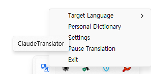

| 메뉴 | 설명 |
|---|---|
| **Target Language** | 번역할 언어를 체크합니다. 여러 개 고를 수 있고, 고른 순서가 번호로 표시됩니다(예: `en (1)`, `vi (2)`). 마지막 하나는 해제되지 않습니다. 바로 저장됩니다. |
| **Personal Dictionary** | [개인 사전](#8-개인-사전) 창을 엽니다. |
| **Settings** | [Settings](#9-settings) 창을 엽니다. |
| **Pause Translation** | 체크하면 단축키가 잠시 동작하지 않습니다. |
| **Exit** | 프로그램을 끝냅니다. |

---

## 4. 번역 후 바꿔 넣기 (Alt+Alt)

입력 중인 글을 번역문으로 바꿉니다. 번역하는 동안 마우스 커서 옆에 "Translating..."이 잠깐 보입니다.

### 4-1. 입력 칸 전체 번역

블록을 선택하지 않고 Alt+Alt를 누르면 입력 중인 칸 전체를 번역합니다.

| 번역 전 | 번역 후 |
|---|---|
|  | 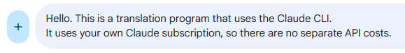 |

### 4-2. 원문과 함께 넣기

Settings에서 **"Alt+Alt 교체 시 원문 포함"**을 켜면 원문을 남기고 빈 줄 아래에 번역문을 넣습니다.

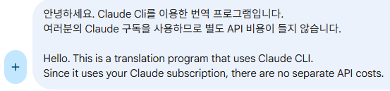

### 4-3. 여러 언어로 한 번에

Target 언어를 여러 개(예: en, vi) 고르면 정한 순서대로 모두 번역해 넣습니다. 원문 포함을 켜면 "원문 → 1번 언어 → 2번 언어" 순서가 됩니다.

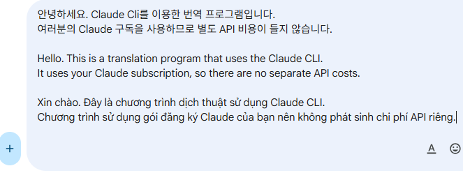

### 4-4. 선택한 부분만 번역

번역할 부분만 블록으로 선택하고 Alt+Alt를 누르면 그 부분만 바뀝니다.

| 블록 선택 | 번역 후 |
|---|---|
| 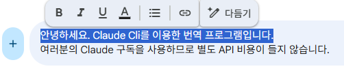 | 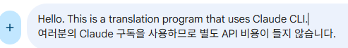 |

---

## 5. 번역 결과 창으로 보기 (Ctrl+Ctrl)

원문은 그대로 두고 번역 결과를 창으로 보여줍니다. 받은 메시지나 메일을 읽을 때, 보내기 전에 번역을 확인할 때 씁니다.

- 원문은 **굵은 검은 글씨**, 번역은 **파란 글씨**로 보입니다.
- Target 언어가 2개 이상이면 번역 앞에 언어 표시(EN, VI 등)가 붙습니다.
- 창의 글자는 드래그해서 복사할 수 있습니다.
- 닫기: 오른쪽 위 **X**, 아래쪽 **"닫기 Esc"**, 또는 **Esc** 키. 창은 끌어서 옮기고, 가장자리를 끌어 크기를 바꿀 수 있습니다.

| 블록을 선택하고 Ctrl+Ctrl | 블록 없이 Ctrl+Ctrl (칸 전체) |
|---|---|
| 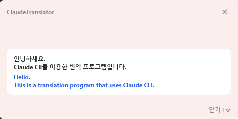 | 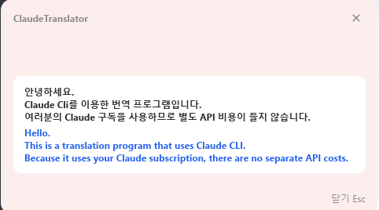 |

**표시 방식**(Settings → 창 모드 번역)

- **원문 전체 · 번역 전체 보기**(기본값): 원문 전체를 한 덩어리로, 그 아래 번역 전체를 보여줍니다.
- **문장별로 보기**: 문장마다 원문과 번역을 짝지어 보여줍니다.

---

## 6. 앱별 동작

| 앱 | Alt+Alt / Ctrl+Ctrl 범위 |
|---|---|
| **Google Chat** | 선택한 부분, 없으면 작성 중인 메시지 전체. Ctrl+Ctrl은 받은 메시지를 드래그해 번역할 수도 있습니다. |
| **Gmail** | 선택한 부분, 없으면 커서가 있는 제목 또는 본문 전체. 받는 사람·참조 칸은 건드리지 않습니다. |
| **Google Docs** | **블록을 선택했을 때만** |
| **Google Slides** | 선택한 부분, 없으면 선택한 텍스트 상자 전체 |
| **Google Sheets** | 셀 범위(단일 셀 포함) 일괄 처리, 또는 편집 중인 셀 |

### Google Docs

Docs는 문서 전체가 하나의 편집 영역이라, 블록을 선택하지 않으면 동작하지 않고 안내만 띄웁니다.

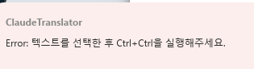

### Google Slides

텍스트 상자를 선택하면(테두리가 보이는 상태) 상자 안 글 전체를 번역합니다. 상자 안을 편집하는 중에도 됩니다.

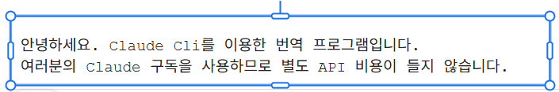

| Ctrl+Ctrl 결과 | Alt+Alt 결과 |
|---|---|
| 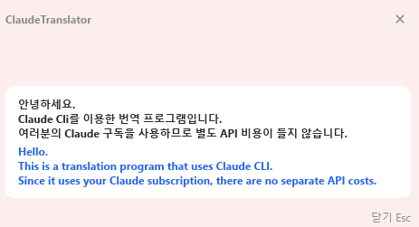 | 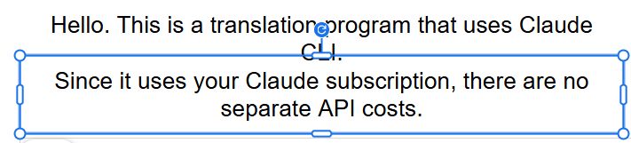 |

### Google Sheets

번역할 **셀 범위를 선택**하고(단일 셀도 됨) 단축키를 누르면 범위 전체를 한 번에 처리합니다.

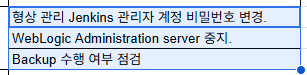

- **Alt+Alt**: 각 셀이 번역문으로 바뀝니다. 셀마다 언어를 따로 판단하므로 한국어 셀과 영어 셀이 섞여 있어도 됩니다(영어 셀은 한국어로 번역). Target이 여러 개이거나 원문 포함이면 한 셀 안에 빈 줄로 나눠 들어갑니다.

  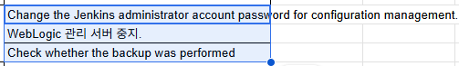

- **Ctrl+Ctrl**: 셀 위치를 그대로 유지한 표로 번역을 보여줍니다. 창 크기를 바꾸면 열 너비가 따라 바뀝니다.

  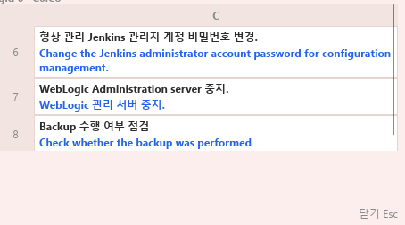

- **셀을 편집 중일 때**(셀을 더블클릭한 상태): 셀 안에서 선택한 글자, 또는 셀 전체를 번역합니다.

**Sheets 안전장치**

- 시트에는 **한 번만** 쓰고, 쓴 뒤 다시 읽어 결과를 확인합니다. 자동으로 다시 붙여넣거나 되돌리지 않습니다.
- 번역하는 동안 다른 탭으로 가거나 셀 내용이 바뀌면 **쓰지 않고 취소**합니다.
- 지원하지 않는 선택(행·열 전체, 떨어진 여러 범위, 병합된 셀, 필터로 숨긴 행, 200칸 초과)은 이유를 알려 주고 멈춥니다. 링크가 있는 셀은 바꿔 넣기만 막고 보기는 됩니다.
- 수식 셀(`=`로 시작)은 번역하지 않습니다. 번역 결과가 `=`나 `+`로 시작해 수식이 될 수 있으면 바꿔 넣지 않습니다.
- 숫자·날짜 셀이 섞인 범위는 "선택한 셀을 읽을 수 없습니다."가 뜰 수 있습니다. 텍스트 셀만 선택해 주세요.

---

## 7. 한글 교정

Base Language가 **ko(한국어)**이고 선택한 글의 주 언어가 한국어일 때 동작합니다.

| 단축키 | 동작 |
|---|---|
| **Ctrl을 누른 채 Alt+Alt** | 교정한 글로 바꿔 넣기 |
| **Alt를 누른 채 Ctrl+Ctrl** | 원문과 교정문을 창으로 보기(원문 변경 없음) |

범위 규칙은 번역과 같습니다(블록, 없으면 입력 칸 전체, Docs는 블록 필수, Sheets는 범위 일괄).

**교정 범위**(Settings → 한글 교정)

- **오탈자, 띄어쓰기 교정**: 맞춤법과 띄어쓰기만 고칩니다. 단어 선택과 어순은 그대로 둡니다.
- **오탈자, 띄어쓰기 교정, 문장 다듬기**: 뜻이 같은 한도에서 더 자연스럽게 다시 씁니다. 짧게 끊긴 문장은 합치고 긴 문장은 나눕니다. 존댓말 수준(합니다체·해요체·반말)과 줄바꿈은 유지합니다. 이모지, 과장된 수식어, 지나친 확신 표현, AI식 표현("혁신적인", "결론적으로" 등)은 원문에 없으면 쓰지 않습니다.

고칠 곳이 없으면 "수정할 부분이 없습니다."가 뜹니다. Sheets에서는 바뀐 한국어 셀만 바꿔 넣습니다.

---

## 8. 개인 사전

번역할 때 **항상 같은 표기로 남기거나, 정해 둔 번역으로 바꾸고 싶은 단어**를 등록합니다. 트레이 메뉴 → Personal Dictionary.

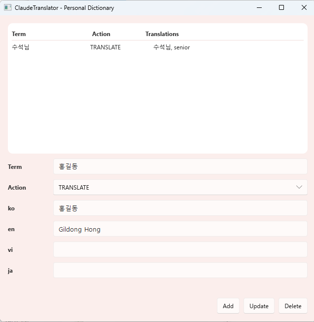

| 항목 | 설명 |
|---|---|
| **Term** | 등록할 단어(원문에 나오는 표기) |
| **Action** | **KEEP**: 번역하지 않고 그대로 둡니다(제품명, 약어 등). **TRANSLATE**: 아래 언어별 표기로 바꿉니다. |
| **ko / en / vi / ja** | TRANSLATE일 때 언어별로 쓸 표기 |

- **Add**: 새로 추가, **Update**: 목록에서 고른 항목 수정, **Delete**: 삭제
- 저장하면 다음 번역부터 바로 적용됩니다. 대소문자는 구분하지 않고, 긴 표기가 먼저 적용됩니다.
- 사전은 `%APPDATA%\ClaudeTranslator\user.yaml`에 저장됩니다.

---

## 9. Settings

트레이 메뉴 → Settings. **Save**를 누르면 저장하고 창을 닫습니다.

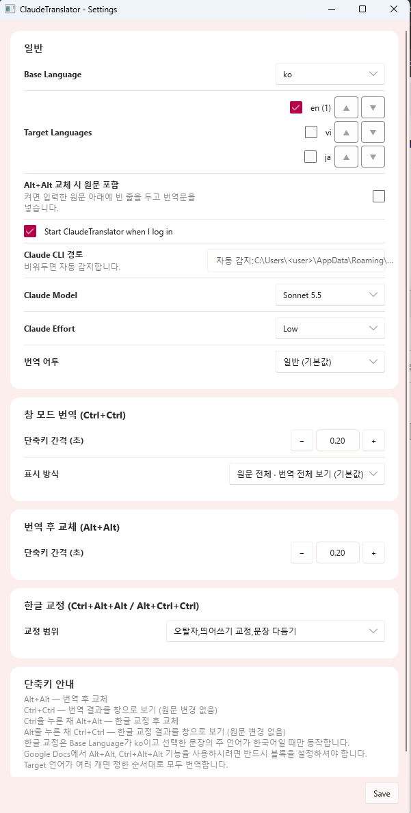

### 일반

| 항목 | 설명 |
|---|---|
| **Base Language** | 내가 주로 쓰는 언어(기본 ko). Base 언어로 쓴 글을 Target 언어로 번역합니다. |
| **Target Languages** | 번역할 언어. 체크한 순서가 번역 순서이며 ▲▼로 바꿉니다. 하나 이상 골라야 합니다. |
| **Alt+Alt 교체 시 원문 포함** | 켜면 원문 아래에 빈 줄을 두고 번역문을 넣습니다. |
| **Start ClaudeTranslator when I log in** | Windows 로그인 때 자동으로 실행합니다. |
| **Claude CLI 경로** | 비워 두면 자동으로 찾습니다. 찾지 못할 때만 `claude.exe` 위치를 직접 넣으세요. |
| **Claude Model / Claude Effort** | 번역에 쓸 모델과 생각 정도. 목록은 설치된 Claude CLI에서 가져옵니다. 빠른 응답에는 Sonnet + Low를 권합니다. |
| **번역 어투** | 일반(기본값), 구어체, 정중하게(회사 공식 메일 등), 쉬운 단어와 문장 |

### 창 모드 번역 (Ctrl+Ctrl)

| 항목 | 설명 |
|---|---|
| **단축키 간격(초)** | Ctrl을 두 번 누르는 간격으로 인정할 시간(0.1~2.0초, 기본 0.2초) |
| **표시 방식** | 원문 전체 · 번역 전체 보기(기본값) / 문장별로 보기 |

### 번역 후 교체 (Alt+Alt)

| 항목 | 설명 |
|---|---|
| **단축키 간격(초)** | Alt를 두 번 누르는 간격으로 인정할 시간(기본 0.2초) |

### 한글 교정

| 항목 | 설명 |
|---|---|
| **교정 범위** | 오탈자·띄어쓰기 교정 / 문장 다듬기까지 ([한글 교정](#7-한글-교정) 참고) |

---

## 10. 안내 메시지와 해결 방법

| 메시지 | 원인과 해결 |
|---|---|
| 텍스트를 선택한 후 Alt+Alt를 눌러주세요. / Ctrl+Ctrl을 실행해주세요. | 번역할 글을 찾지 못했습니다. Docs라면 블록을 선택하세요. 입력 칸에 커서를 두고 다시 눌러 보세요. |
| Claude CLI를 실행할 수 없습니다. Settings의 Claude CLI 경로를 확인하세요. | Claude CLI를 찾지 못했거나 실행이 막혔습니다. `claude` 설치와 로그인을 확인하고, Settings에서 경로를 지정하세요. |
| 번역 방향을 판단할 수 없어 원문을 변경하지 않았습니다. | Base·Target 언어가 아닌 글이거나, 한 칸에 여러 언어가 섞여 있습니다(이미 번역한 셀을 다시 번역한 경우 등). |
| 번역에 실패하여 원본을 변경하지 않았습니다. | Claude 응답을 받지 못했습니다. 잠시 뒤 다시 시도하세요. |
| 한글 교정은 Base Language가 ko(한국어)일 때만 사용할 수 있습니다. | Settings의 Base Language를 ko로 바꾸세요. |
| 선택한 문장의 주 언어가 한국어가 아니어서 교정하지 않았습니다. | 한국어 글에서만 교정합니다. |
| 셀 내용이 너무 깁니다. 더 작은 텍스트를 선택해주세요. | Target 언어가 많거나 원문 포함으로 셀 내용이 너무 길어졌습니다. 범위나 Target 수를 줄이세요. |
| 번역 중 시트·선택 범위 또는 내용이 바뀌어 교체를 취소했습니다. 다시 실행해주세요. | 번역하는 동안 탭을 옮기거나 셀을 고쳤습니다. 시트는 바뀌지 않았습니다. |
| 교체 결과를 확인할 수 없습니다. 시트 내용을 직접 확인해주세요. | 시트에는 썼지만 확인하지 못했습니다. 셀 내용을 직접 확인하세요. |
| 이 선택 범위는 지원하지 않습니다: … | 행·열 전체, 여러 범위, 병합 셀, 숨긴 행, 너무 큰 범위 등. 메시지의 이유를 확인하세요. |

---

## 11. 데이터와 로그 위치

모두 `%APPDATA%\ClaudeTranslator` 폴더에 있습니다.

| 파일 | 내용 |
|---|---|
| `settings.yaml` | 설정 |
| `user.yaml` | 개인 사전 |
| `models_cache.json` | Claude 모델 목록 캐시 |
| `logs\claudetranslator.날짜.log` | 동작 로그. 번역할 글이나 셀 내용은 남기지 않고 작업 종류, 상태, 소요 시간, 오류 종류만 남깁니다. |

---

## 12. 소스에서 빌드하기

1. Rust 설치: https://rustup.rs
2. Visual Studio Build Tools 설치: "C++를 사용한 데스크톱 개발" 항목 선택(Windows SDK 포함)
3. 소스 받기:

   ```powershell
   git clone https://github.com/ixuskiss/ClaudeTranslatorRust.git
   cd ClaudeTranslatorRust
   ```

4. 실행(개발 중):

   ```powershell
   cargo run -p ct-app --release
   ```

5. 배포용 단일 exe 만들기:

   ```powershell
   $env:RUSTFLAGS = "-C target-feature=+crt-static --remap-path-prefix=$env:USERPROFILE=~ --remap-path-prefix=$PWD=."
   cargo build --release -p ct-app
   Copy-Item target\release\ct-app.exe dist\ClaudeTranslator.exe
   ```

   - `+crt-static`: Visual C++ 런타임을 exe 안에 넣습니다.
   - `--remap-path-prefix`: exe 안에 들어가는 소스 경로에서 PC 사용자 폴더 이름을 지웁니다.
   - 실행 중인 `ClaudeTranslator.exe`는 덮어쓸 수 없으니 먼저 트레이에서 Exit 하세요.

처음 빌드할 때는 라이브러리를 받아 전체를 컴파일하므로 10분 정도 걸립니다. `target` 폴더는 빌드 결과물이라 git에 올리지 않습니다.

### 검사

```powershell
cargo test --workspace
cargo clippy --workspace -- -D warnings
cargo fmt --check
```

### 구조

| 크레이트 | 역할 |
|---|---|
| `ct-core` | 설정, 개인 사전, 언어 판별, 번역·교정 서비스, 배치 처리 |
| `ct-llm` | Claude CLI 클라이언트, 프롬프트, 모델 목록 |
| `ct-sheets` | Google Sheets 셀 모델, 클립보드 HTML 파서, 교체·검증 |
| `ct-win` | 키보드 훅, UI Automation, 클립보드, Sheets 백엔드 |
| `ct-app` | 트레이, Slint 창, 단축키 흐름, 조립 |

- 아이콘은 `crates/ct-app/assets/make_icon.ps1`로 만듭니다(트레이용 32px 이미지와 exe용 `app.ico`).
- 설계와 계획 문서는 `docs/superpowers/`에, 수동 테스트 절차는 `tests/manual/`에 있습니다.
